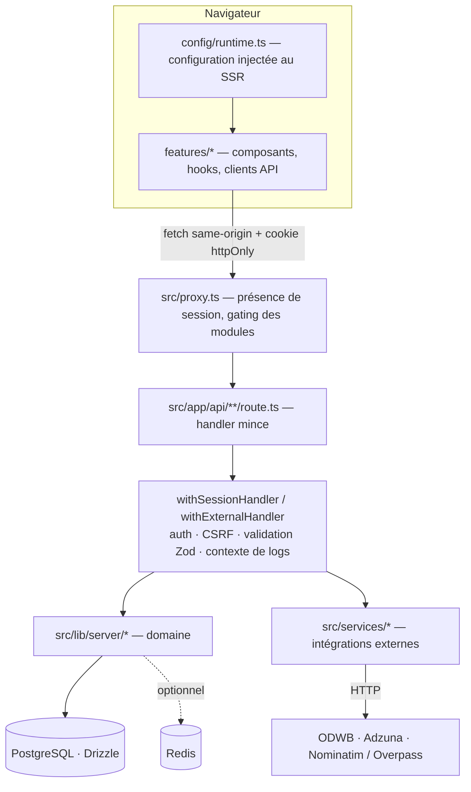

# Architecture

## Vue d'ensemble

Le produit est **mono-tenant** : une instance sert un établissement, avec sa
propre base et son propre branding injecté par variables d'environnement.

## Les couches

| Dossier | Rôle | Règle |
|---|---|---|
| `src/app/` | Routes App Router, pages serveur, handlers HTTP | **Mince** : lire la requête, appeler le domaine, répondre. Pas de règle métier. |
| `src/features/` | Découpage par fonctionnalité (UI + hooks + client API + tests) | Une feature n'importe pas les internes d'une autre feature ; elle passe par le client API ou un utilitaire partagé. |
| `src/services/` | Intégrations externes (offres, géocodage, providers) | Aucun accès à la base ni au cookie de session : testable sans Next. |
| `src/lib/server/` | Domaine serveur : auth, sessions, RBAC, messagerie, conformité, audit, rate limiting | Seul endroit qui touche PostgreSQL, Redis et la crypto. |
| `src/lib/` (racine) | Règles pures et partagées (`authz.ts`, `utils.ts`) | Sans effet de bord, sans I/O. |
| `src/components/` | Primitives shadcn/ui (`ui/`) et composants transverses | Présentation ; pas de règle métier. |
| `src/config/` | Configuration runtime (`runtime.ts` client, `runtime.server.ts` serveur, `env.ts`) | Toute lecture d'environnement passe par ici. |
| `src/types/` | Types partagés client/serveur | Aucune logique. |

## Cycle d'une requête API

1. **`src/proxy.ts`** — vérifie la présence du cookie de session et applique le
   gating des modules optionnels (par exemple `FEATURE_JOB_SEARCH`) avant
   d'atteindre la route.
2. **`src/app/api/**/route.ts`** — handler mince : il choisit le wrapper, décrit
   le schéma du corps et délègue.
3. **`withSessionHandler`** (`src/lib/server/apiHandler.ts`) :
   - résolution de l'accès (`user` | `coach` | `admin`) via `getCurrentUser`,
     `requireCoachAccess`, `requireAdminAccess` ;
   - rejet des requêtes cross-origin (`rejectCrossOriginRequest`, basé sur
     `APP_BASE_URL` ou `x-forwarded-proto` / `x-forwarded-host`) ;
   - validation du corps par schéma Zod (`readValidatedJson`) ;
   - ouverture du contexte de logs (`withRequestContext`, `requestId`).
   `withExternalHandler` remplace l'étape d'authentification par une clé d'API
   pour les endpoints de reporting.
4. **Domaine** (`src/lib/server/*`) — règles métier, requêtes Drizzle ou SQL
   paramétré pour les cas complexes (CTE, `LATERAL`).
5. **Erreurs** — `handleApiError` traduit l'erreur remontée en statut HTTP et
   message ; un handler ne construit pas de réponse d'erreur à la main.
6. **Observabilité** — `logServerEvent({ category, action, level, meta })` écrit
   une ligne structurée, corrélée au `requestId`. Pas de `console.log` dans le
   code applicatif.

## Conventions transverses

- **Validation** : un schéma Zod par domaine (`requestSchemas.ts`,
  `messagingSchemas.ts`, `applicationSchemas.ts`, `scoutSchemas.ts`), réutilisé
  par le client et le serveur plutôt que dupliqué.
- **Configuration** : jamais `process.env` dans un composant. La configuration
  publique est sérialisée au SSR dans `window.__APP_RUNTIME_CONFIG__` et lue via
  `config/runtime.ts` ; la configuration serveur passe par `runtime.server.ts`.
  Conséquence : changer le branding ne demande **aucun rebuild**.
- **Redis est optionnel** : le rate limiting, le cache d'offres et le pub/sub de
  messagerie dégradent vers un repli en mémoire quand `REDIS_URL` est absent ou
  injoignable (`lib/server/redisConnection.ts` porte ce contrat).
- **Migrations** : versionnées dans `drizzle/`, générées avec
  `npm run db:generate`, jamais écrites à la main dans la base.

## Ajouter une fonctionnalité

1. Écrire le schéma Zod de l'entrée (fichier `*Schemas.ts` du domaine).
2. Implémenter la règle dans `src/lib/server/` (et le client HTTP dans
   `src/services/` si une API tierce est concernée).
3. Exposer une route avec le bon wrapper (`withSessionHandler` + `access`).
4. Construire l'UI dans `src/features/<domaine>/` avec les primitives
   `src/components/ui/`, et un hook portant l'état de la page.
5. Ajouter les tests : unitaires pour la logique et les utilitaires, E2E si le
   parcours est utilisateur-visible.
6. Documenter : un ADR si la décision est structurante, sinon une ligne dans le
   document concerné de `docs/`.

## Décisions structurantes

Les arbitrages sont documentés en ADR :

- [0001 — authentification maison](adr/0001-auth-maison.md)
- [0002 — wrappers d'API](adr/0002-wrappers-api.md)
- [0003 — configuration runtime](adr/0003-config-runtime.md)
- [0004 — vocabulaire « classe »](adr/0004-vocabulaire-classe.md)
- [0005 — tables mortes](adr/0005-tables-mortes.md)
- [0006 — cache et budget d'offres](adr/0006-cache-budget-offres.md)

## Limites connues

- **Mono-tenant** : pas de partition multi-établissements dans une même base.
- **Authentification maison** : pas de SSO ni de MFA ; l'autorisation étant
  isolée dans `src/lib/authz.ts`, une migration resterait localisée (ADR-0001).
- **Couverture unitaire partielle** : les pages et handlers App Router sont
  couverts par les tests E2E plutôt que par des tests unitaires, ce qui explique
  le chiffre global (voir [testing.md](testing.md)).
